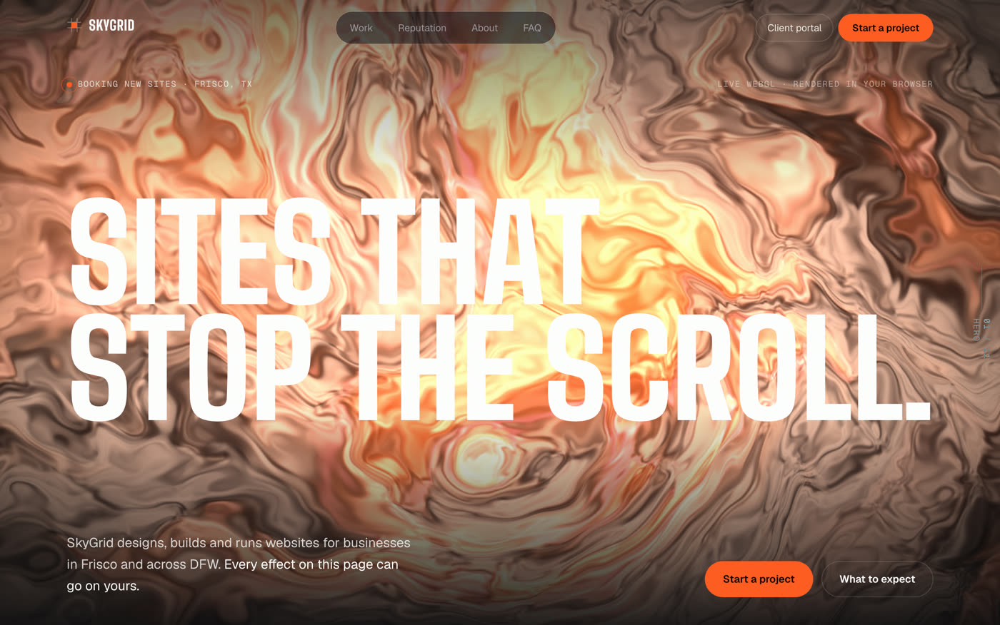
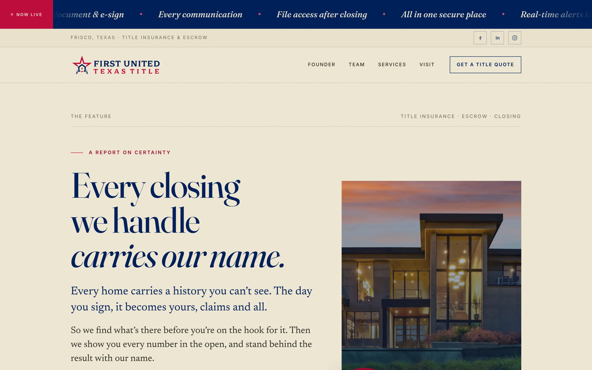
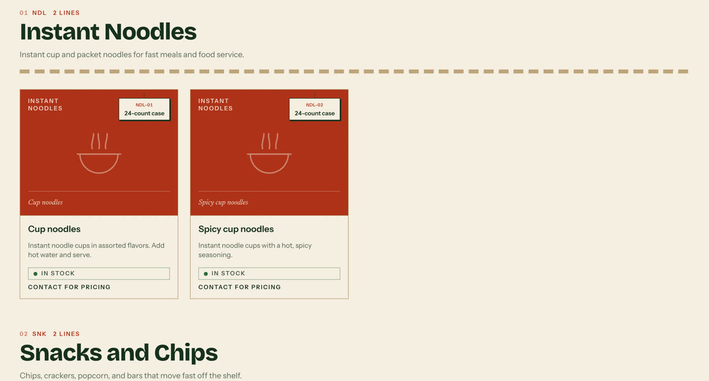
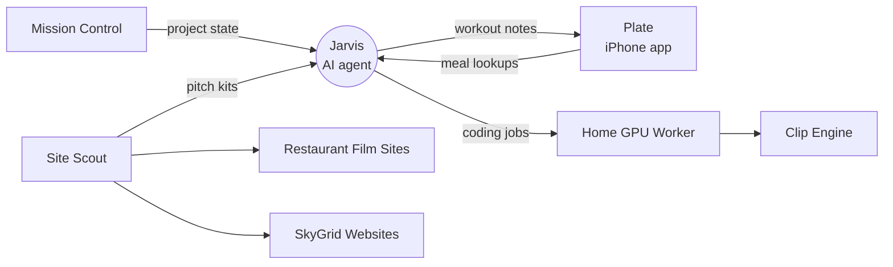

# Hi, I'm Manvith 👋

I design, build and ship software end to end: **native iOS apps, AI agents that do real work, video pipelines, and websites for local businesses.** Almost everything here was built solo, with Claude Code as my main tool.

**18 projects** · **4 live sites** · **2 iPhone apps** · **1 personal AI agent running 24/7**

> The code lives in private repos. Each project below has a full plain-English write-up: what it does, how it works, and where it could go. Click any name.

---

## ⭐ Start here

<table>
<tr>
<td width="33%" valign="top">

### [Jarvis](projects/jarvis.md)
My personal AI agent in Telegram. It remembers my life in a notes vault, triages email, drives a real browser, and writes code that lands as pull requests.

</td>
<td width="33%" valign="top">

### [Plate](projects/plate.md)
An iPhone nutrition and training tracker that replaced MyFitnessPal for me: 382k foods searchable offline, AI meal lookup, 570+ tests.

</td>
<td width="33%" valign="top">

### [Clip Engine](projects/clip-engine.md)
Long video in, finished vertical clips out. It picks the moments, follows whoever is talking, captions, quality-checks and writes the posts.

</td>
</tr>
</table>

---

## 🌐 Live sites you can open

<table>
<tr>
<td width="50%" valign="top">

<b><a href="projects/skygrid-websites.md">SkyGrid Websites</a></b> · my web studio · <a href="https://skygridwebsites.vercel.app">open ↗</a>
</td>
<td width="50%" valign="top">

<b><a href="projects/first-united-site.md">First United Texas Title</a></b> · client · <a href="https://firstunitedtexastitle.com">open ↗</a>
</td>
</tr>
<tr>
<td width="50%" valign="top">

<b><a href="projects/skygrid-aerials.md">SkyGrid Aerials + AI chat</a></b> · drone business · <a href="https://skygrid-site.vercel.app">open ↗</a>
</td>
<td width="50%" valign="top">

<b><a href="projects/caribexports.md">CaribExports</a></b> · client · <a href="https://caribexports.net">open ↗</a>
</td>
</tr>
</table>

---

## 🧭 How it fits together

Most of these projects talk to each other. Jarvis sits in the middle.

---

## 📂 All projects

**Status:** 🟢 live or in use · 🟡 in progress · ⚪ archived or concept

### 📱 Apps
| | Project | In one line | Built with |
|---|---|---|---|
| 🟢 | [Plate](projects/plate.md) | Nutrition + training tracker that replaced MyFitnessPal | SwiftUI, SwiftData, CloudKit |
| 🟡 | [Ingot](projects/ingot.md) | Earn screen time with focus instead of having apps banned, plus a desk dock concept | SwiftUI, Screen Time APIs |
| ⚪ | [Compass](projects/compass.md) | Hackathon app that keeps beginner investors from panic selling | Next.js, Claude, SEC, FRED |

### 🤖 AI agents and automation
| | Project | In one line | Built with |
|---|---|---|---|
| 🟢 | [Jarvis](projects/jarvis.md) | Personal AI agent: memory, email, browser, coding, worker teams | TypeScript, Claude Agent SDK |
| 🟢 | [Mission Control](projects/mission-control.md) | One dashboard (web, iPhone, widgets) for 20+ projects | Python, vanilla JS, SwiftUI |
| 🟡 | [Home GPU Worker](projects/home-pc.md) | Gaming PC turned into a safe, always-on GPU worker | Windows, WSL2, CUDA |
| 🟢 | [Underwriting Engine](projects/underwriting-engine.md) | Reads a real estate offering memo, recomputes it, verifies it, models it | Python, AI extraction |

### 🎬 Video and media
| | Project | In one line | Built with |
|---|---|---|---|
| 🟢 | [Clip Engine](projects/clip-engine.md) | Long video to finished vertical clips with captions and post copy | Python, Whisper, OpenCV |
| 🟡 | [SkyGrid Auto-Editor](projects/skygrid-auto-editor.md) | Search drone footage in plain English, auto-cut reels to music | Python, YOLO, CLIP |
| ⚪ | [Reel Captioner](projects/reel-captioner.md) | Local captions plus titles and hashtags for every platform | Python, Whisper, ffmpeg |
| 🟢 | [Title Company Media Engines](projects/futt-media.md) | Flyer engine with AI art review + 8-stage founder video editor | Python, Playwright, WhisperX |

### 🌐 Websites and the web business
| | Project | In one line | Built with |
|---|---|---|---|
| 🟢 | [Site Scout](projects/site-scout.md) | Finds businesses with broken sites, builds a preview, preps the pitch | Python, Places API, Next.js |
| 🟡 | [Restaurant Film Sites](projects/restaurant-film-sites.md) | Every dish a short AI film made from the restaurant's own photos | Next.js, AI image + video |
| 🟢 | [SkyGrid Websites](projects/skygrid-websites.md) | My web studio's site and client portal | Next.js 16, Tailwind v4 |
| 🟢 | [SkyGrid Aerials + AI Chat](projects/skygrid-aerials.md) | Drone business site with a lead-capturing AI chat | Next.js, FastAPI, ChromaDB |
| 🟢 | [First United Texas Title](projects/first-united-site.md) | Editorial website for a title company | Next.js, Tailwind |
| ⚪ | [CaribExports](projects/caribexports.md) | Catalog site for a Caribbean wholesale food supplier | Next.js, Tailwind |
| 🟡 | [Campus Mobility Presentation](projects/ecs2390-presentation.md) | Six-version cinematic deck from one engine | HTML, CSS, JS |

---

## 🛠 How I work

- **Ship the whole thing:** design, build, test, deploy, and keep it running.
- **Real data only:** no invented testimonials, numbers or food photos.
- **Zero-maintenance by default:** boring, free-forever infrastructure over anything that expires.
- **Every project keeps a STATUS file**, so any session, human or AI, knows the next step.

**Portfolio site coming soon.**
