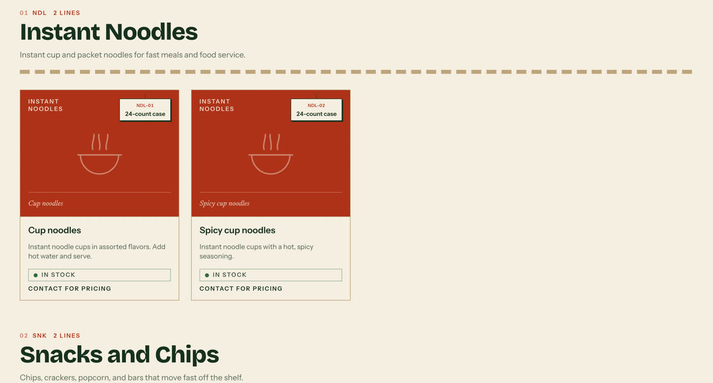
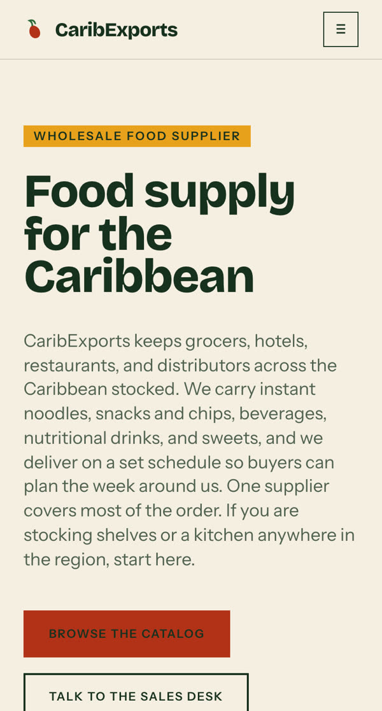

[← All projects](../README.md)

# CaribExports

> A catalog site for a Caribbean wholesale food supplier that keeps grocers, hotels, restaurants and distributors stocked.

  
  

| At a glance | |
|---|---|
| **What** | Catalog site for a Caribbean wholesale food supplier |
| **For** | Grocers, hotels, restaurants and distributors |
| **Status** | ⚪ Live, archived |
| **Built with** | Next.js · Tailwind |
| **See it** | [caribexports.net](https://caribexports.net) |

**Jump to:** [The brief](#the-brief) · [What's on it](#whats-on-it) · [How it's built](#how-its-built) · [Possibilities](#possibilities)

---

## The brief

Buyers across the Caribbean (grocers, hotels, restaurants, distributors) needed a credible way to see what the company carries, check case sizes and stock, and start an order, without a brochure PDF or a phone call.

## What's on it

- A design direction called **"The Manifest"**, inspired by shipping manifests and trade documents.
- A **product catalog** by category (instant noodles, snacks and chips, beverages, nutritional drinks, sweets), each item with its case size, code and stock status.
- An **order desk** and a sales desk contact so buyers can plan the week around a set delivery schedule.
- All copy kept in a single content file so it can be updated without touching layout.

## How it's built

- Next.js 16, React 19, Tailwind v4, TypeScript.
- Vercel hosting with automatic deploys from GitHub.
- **Company email** set up on the domain: Google Workspace mail records and verification.

## Possibilities

- **Online ordering** with case quantities and a standing weekly order.
- **Live stock** synced from the warehouse.
- **Buyer accounts** with order history and invoices.

---

[← All projects](../README.md)
