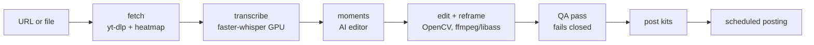

[← All projects](../README.md)

# Clip Engine

> Long video in, finished vertical clips out. Give it a podcast or interview and it returns ready-to-post 9:16 clips with captions, smart framing and per-platform post copy.

| At a glance | |
|---|---|
| **What** | Long video in, finished vertical clips out |
| **For** | Clip channels and podcasters |
| **Status** | 🟢 Running on my GPU PC |
| **Built with** | Python · Whisper · OpenCV · ffmpeg |
| **See it** | Private |

**Jump to:** [The problem](#the-problem) · [What it does](#what-it-does) · [How it works](#how-it-works) · [How the editing rules were made](#how-the-editing-rules-were-made) · [Possibilities](#possibilities)

---

## The problem

Clipping long-form video by hand takes hours per episode: finding the moments, cutting clean sentences, reframing a wide shot for vertical, captioning, then writing a caption for every platform. Existing auto-clippers pick weak moments, cut mid-sentence, and frame the wrong person. I wanted output good enough to post without touching it.

## What it does

1. **Fetch.** Downloads the video (up to 1080p) and YouTube's **"most replayed" heatmap**. For long episodes it reads captions and heat first, then downloads **only the sections it picked**.
2. **Transcribe.** Local speech-to-text with **word-level timestamps** on the GPU (a 10-minute video transcribes in about 34 seconds).
3. **Find the moments.** An AI editor reads the timed transcript next to the heat peaks and picks clips that have a **hook, a standalone idea and a payoff**. Audience heat blends into the ranking.
4. **Cut like an editor.**
   - Snaps to whole sentences.
   - Drops leading filler ("so, like, well") and trailing chatter.
   - Removes long pauses (both transcript gaps and real audio silence) and stutters.
5. **Frame for vertical.**
   - A 4:5 window over a blurred background.
   - Follows **whoever is talking**, detected by mouth movement, with a short hold so it doesn't jitter.
   - Zooms small faces, frames faceless footage by motion, and shows static graphics whole.
   - A gentle punch-in every few seconds on long shots.
6. **Finish.** Word-by-word captions, a short hook header (3 to 7 words that open a loop and never give away the payoff), a creator tag, bleeped profanity, loudness normalized for social platforms, 1080x1920 at 30 fps.
7. **Review.** A final AI pass scores each clip on hook pull, standalone sense, payoff, niche fit, brand safety and whether the hook matches the exact words heard. **It fails closed**, and rejects conspiracy, tragedy and accusation content.
8. **Post kit.** Separate captions and hashtags for TikTok, YouTube Shorts, Instagram and Facebook, with a credit line.

### Niches and automation
- **Niche channels:** register source channels per niche ("finance", etc.) with audience notes; it clips each one's newest uploads.
- **Daily run:** clip, verify, then queue posts into the next free slots through an official posting service (not browser automation, which platforms ban).
- **Ledger** so nothing is ever posted twice.

## How it works

- Python 3.12, faster-whisper, OpenCV face detection, yt-dlp, ffmpeg with libass.
- Every stage **caches** its output, so re-running or re-picking is cheap.
- Runs as a system service on a Windows PC with an RTX GPU (inside Linux on WSL), with a small private web page to queue jobs, manage topics, and find the original video behind a TikTok.

## How the editing rules were made

The rules above weren't guessed. They came from **seven rounds of reviewing real output**, fixing what a human editor would have flagged each time.

## Possibilities

- **Speaker-aware layouts:** split-screen when two people trade lines quickly.
- **B-roll insertion** pulled from the episode itself when someone references something on screen.
- **Performance loop:** feed post analytics back into moment ranking per niche.
- **Multi-language** captions and dubbing.
- **Clips-as-a-service** for podcasters, priced per episode.

---

[← All projects](../README.md)
