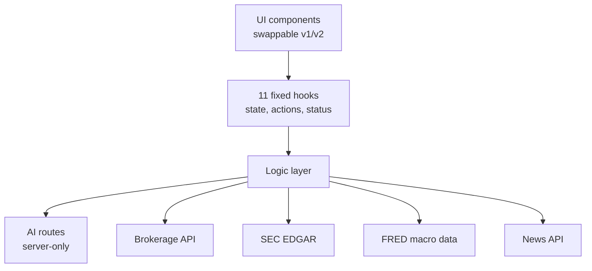

[← All projects](../README.md)

# Compass

> A portfolio companion for everyday investors who panic during uncertainty. Built for a hackathon themed "Empowering the Everyday Investor."

| At a glance | |
|---|---|
| **What** | Calm, explain-everything portfolio app for beginner investors |
| **For** | First-time investors who panic in a downturn |
| **Status** | ⚪ Hackathon build |
| **Built with** | Next.js · Claude · SEC EDGAR · FRED |
| **See it** | Private |

**Jump to:** [The problem](#the-problem) · [What it does](#what-it-does) · [How it's built](#how-its-built) · [Possibilities](#possibilities)

---

## The problem

Beginner investors don't lose money because they lack data. They lose it because they sell in a panic. Brokerage apps show red numbers and a big sell button. Compass is designed around **calm, explanation and friction in the right places**.

## What it does

- **Sleep Test onboarding.** Instead of a risk quiz, a slider asks how far your portfolio could drop before you couldn't sleep. That dollar number is treated as sacred everywhere else in the app.
- **Adaptive dashboard.** Every widget is gated by onboarding answers, so two people with different worries see different layouts.
- **Worry Translator.** Type any fear in plain English ("is a recession coming?") and get a calm reframing grounded in **today's real macro data** (inflation, the Fed funds rate, the 10-year yield, mortgage rates). Never buy or sell advice.
- **Headline Decoder.** Trending business headlines are classified as **Noise, Watch or Act**, each with a one-paragraph translation.
- **Behavioral Circuit Breaker.** Every sell opens a 60-second pause and asks for a typed reason. Cancelling is the encouraged outcome, and it builds an **Anti-Panic Streak**.
- **Mutual Fund X-Ray.** Real top holdings from SEC EDGAR fund filings, with the filing date cited.
- **"Show me the math"** on every number, because trust needs receipts.
- **Real brokerage connection** through an aggregation API, with signed and verified webhooks.

## How it's built

- Next.js (App Router), TypeScript, Tailwind, Framer Motion, Zustand, Recharts, the Claude API.
- **Three strictly separated layers.** UI only talks to hooks, hooks have fixed signatures, and only the logic layer touches APIs and keys, so the whole UI can be swapped without touching anything else.
- **Degrades gracefully:** with no keys at all it runs on seeded data and deterministic fallbacks, so a demo never breaks.
- A **pre-commit secret scanner** so keys never land in git.

## Possibilities

- **Panic forecasting:** warn before a scary week (earnings, Fed meetings) with a prepared plan.
- **Couples mode:** shared Sleep Test and rules for a household.
- **Advisor handoff:** a clean summary to share with a human advisor.

---

[← All projects](../README.md)
