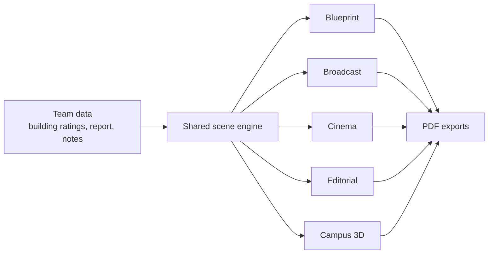

[← All projects](../README.md)

# Campus Mobility Presentation System

> A cinematic presentation built for a university technical communication team project on campus accessibility, with six complete visual versions generated from one shared engine.

| At a glance | |
|---|---|
| **What** | A six-version cinematic deck from one engine |
| **For** | A university team presenting campus accessibility findings |
| **Status** | 🟡 Team choosing a version |
| **Built with** | HTML · CSS · JS |
| **See it** | Private |

**Jump to:** [The project](#the-project) · [What it is](#what-it-is) · [How it's built](#how-its-built) · [Possibilities](#possibilities)

---

## The project

Our team evaluated campus buildings for mobility access and recommended improvements, including a mobility access map. I built the presentation system that carries the team's findings.

## What it is

- A **20-scene deck** built around a "walk the route" concept: the audience follows a person moving between buildings and sees each barrier where it happens.
- Runs as a **single offline HTML file**, so it plays on any classroom computer with no internet, plus a **PDF export** as a backup.
- **Six versions** of the same content from one engine, so the team could pick a personality:
  - Original walk-the-route
  - Blueprint
  - Broadcast
  - Cinema
  - Editorial
  - Campus 3D
- A chooser page to compare them side by side.

## How it's built

- Plain HTML, CSS and JavaScript with a shared scene engine and a build script that renders every version and its PDF.
- All content comes from the team's own ratings, report draft and notes.

## Possibilities

- **Presenter mode** with notes and a timer.
- **Interactive map** handout people can open on their phones during the talk.

---

[← All projects](../README.md)
