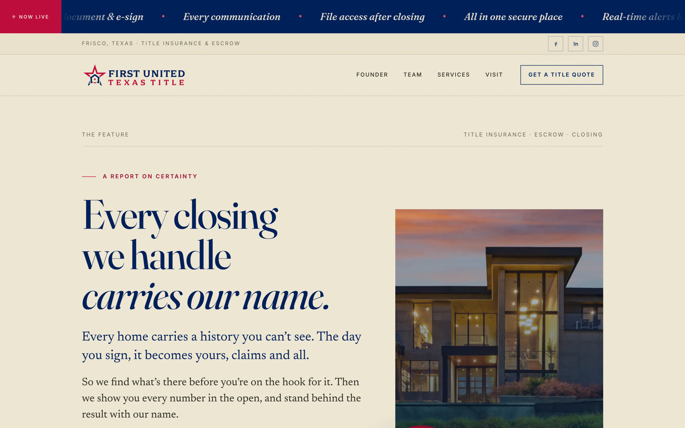
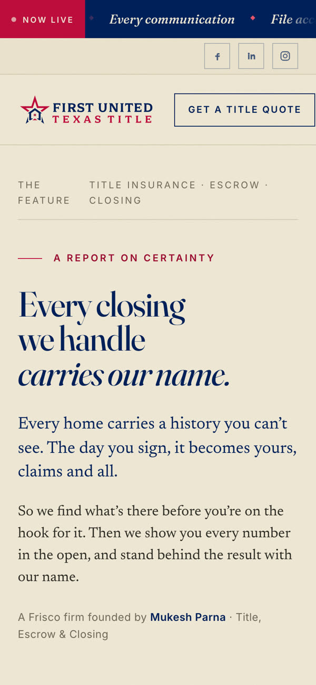

[← All projects](../README.md)

# First United Texas Title Website

> An editorial website for a Texas title company, designed and built end to end.

  
  

| At a glance | |
|---|---|
| **What** | Editorial website for a Texas title company |
| **For** | Realtors, lenders, buyers and sellers |
| **Status** | 🟢 Live |
| **Built with** | Next.js · Tailwind · shadcn/ui |
| **See it** | [firstunitedtexastitle.com](https://firstunitedtexastitle.com) |

**Jump to:** [The brief](#the-brief) · [What's on it](#whats-on-it) · [How it's built](#how-its-built) · [The bigger system](#the-bigger-system) · [Possibilities](#possibilities)

---

## The brief

Title companies usually have forgettable, template websites. First United wanted to look like the established, trustworthy firm it is, while making it easy for realtors, lenders and buyers to start an order.

## What's on it

- An **editorial design** that reads like a well-made magazine rather than a template.
- A **founder profile** and a **team section** for six people.
- A **wax seal** motif that ties to the idea of a document being sealed and certain.
- A **custom cursor** and **smooth scrolling** for a premium feel on desktop, with a fast, simple phone version.
- A direct **"order title" button** connected to the company's title production software.
- Clear paths for each audience: realtors, lenders, buyers and sellers.

## How it's built

- Next.js 16, React 19, Tailwind v4, shadcn/ui.
- Deployed on Vercel with push-to-deploy on the main branch.
- An earlier editorial version was built first and then superseded by the redesign that now serves the live domain.

## The bigger system

The site was one part of a full marketing toolkit for the company, alongside a [flyer engine and a founder video editor](futt-media.md).

## Possibilities

- **Closing cost calculator** for buyers and sellers.
- **Realtor portal** with order status.
- **Local market pages** per county for search.

---

[← All projects](../README.md)
