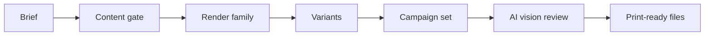

[← All projects](../README.md)

# Title Company Media Engines

> Two production tools built for [First United Texas Title](https://firstunitedtexastitle.com): a flyer engine that turns a brief into on-brand print, and a video editor that turns a raw founder recording into a finished social reel.

| At a glance | |
|---|---|
| **What** | Flyer engine + founder video editor for a title company |
| **For** | A title company's marketing |
| **Status** | 🟢 Used in production |
| **Built with** | Python · Playwright · WhisperX |
| **See it** | Private (client) |

**Jump to:** [Flyer Engine](#flyer-engine) · [Founder Video Editor](#founder-video-editor) · [Possibilities](#possibilities)

---

## Flyer Engine

### The problem
A title company markets constantly to realtors and lenders: rate sheets, closing checklists, event invites, holiday cards. Each flyer took a designer's afternoon, and quality drifted from one to the next.

### What it does
- **11 design families**, each a full system rather than a template: certificate and deed styles with seals and guilloche borders, editorial layouts, data-driven sheets and more.
- **Content gate:** checks the copy for accuracy and tone before anything renders.
- **Render:** HTML and CSS layouts rendered to print-ready output with a headless browser.
- **Variants:** several takes of each flyer to choose from.
- **Campaigns:** a matched set across formats from one brief.
- **AI vision review:** a model looks at every finished flyer like an art director and flags problems before it ships.

### What we learned
The client rejected sparse, big-type minimalism as generic. **Density won**: the deed-style family with a seal, guilloche and certificate detail became the benchmark for the rest.

### Built with
Python 3.12, Playwright, the Claude API. 34 tests.

---

## Founder Video Editor

### The problem
The founder records short explainers on a phone. Turning a raw clip into a polished reel meant noise cleanup, cutting, motion graphics, captions and music: hours per video.

### What it does
An **eight-stage pipeline**, each stage reviewable before moving on:
1. **Intake** and project setup with a preset (for example, "reel explainer").
2. **Transcribe** with word timing.
3. **Clean audio:** noise reduction tuned for voice.
4. **Rough cut:** removes mistakes and pauses, then locks once approved.
5. **Motion graphics:** an approved plan of callouts, titles and highlights per segment, built from HTML animation and rendered to video.
6. **Captions** in the brand style.
7. **Music** ducked under the voice.
8. **Master and verify:** checks sync, grid alignment and the end of the file before export.

### Multi-take mode
For scripted videos the founder records several takes. The editor **aligns every take against the script**, builds the best version of each line, and shows a **take board** to swap any line, with a subtle punch-in zoom to hide cuts.

### Driven in plain language
"do the rough cut", "lock the cut", "seg-03: move the callout down, make 'escrow' crimson".

### Built with
Python 3.12, WhisperX, ffmpeg noise reduction, HTML-based motion graphics, Claude Code as the operator. Two videos shipped.

## Possibilities
- **Self-serve portal** where staff request a flyer from a form.
- **Weekly rate sheet** generated automatically from a data feed.
- **Video templates** for recurring series (market update, closing tips).

---

[← All projects](../README.md)
