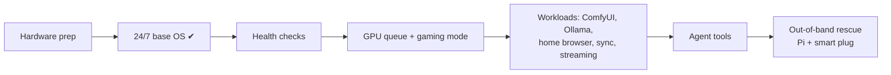

[← All projects](../README.md)

# Home GPU Worker

> Turning a gaming PC into a safe, always-on GPU worker for my AI agent and media pipelines, set up almost entirely remotely.

| At a glance | |
|---|---|
| **What** | A gaming PC turned into an always-on GPU worker |
| **For** | My agent and media pipelines |
| **Status** | 🟡 Base system live, roadmap in progress |
| **Built with** | Windows · WSL2 · CUDA · systemd |
| **See it** | Private |

**Jump to:** [The problem](#the-problem) · [The design](#the-design) · [What's set up](#whats-set-up) · [Tool evaluation](#tool-evaluation) · [Roadmap](#roadmap) · [Possibilities](#possibilities)

---

## The problem

My AI agent lives on a small cloud server with no GPU. Video transcription, rendering and local models need one. I had a Windows PC with an RTX 2070 Super at home, but it slept, needed someone at the keyboard, and the home router can't wake it over the network. The goal: **on 24/7, safe for the hardware, recovers on its own**, and does heavy work for the agent while I'm away.

## The design

- **The cloud server stays the brain, the Mac is where I work, the phone is the remote, and the PC is the muscle.**
- **Always on, restarted every two days** on a schedule, instead of sleep and wake timers. Cold starts are heat cycles too, so steady idle is gentler.
- **Hardware care built into the plan:** GPU power cap (~75%), temperature targets and alerts, dust and repaste schedule, UPS, SSD health checks. Expected power cost about $8 to $12 a month.

## What's set up

- **One script** that prepares Windows for 24/7 use: power plan, scheduled restarts, GPU power cap, SSH key-only login (password login refused).
- **Remote tooling:** Node, Python, ffmpeg with hardware encoding, GitHub CLI, BIOS virtualization and memory profile enabled.
- **Linux inside Windows (WSL2)** with systemd, kept alive permanently (idle timeouts off plus a keep-alive task), because background jobs there die with their session otherwise.
- **GPU video stack:** CUDA speech-to-text, hardware encoding, subtitle rendering, verified end to end.
- **Agent coding jobs:** my agent's `/code` command works on this PC and opens pull requests; a pre-push guard only lets agent branches leave the machine.
- **Clip Engine** running as a system service on the GPU.

## Tool evaluation

Before adopting tools on the PC I benchmarked them in a small eval harness:
- WhisperX: worth it for tighter word timing.
- Scene detection: accurate but optional.
- Auto-editor: redundant with my own pipeline.
- A popular open-source clipper: needs more RAM than the machine has.

## Roadmap

## Possibilities

- **Gaming mode:** pause the queue automatically when I sit down to play.
- **Local image and video models** (ComfyUI) for free renders.
- **Local LLMs** for private, unlimited small tasks.
- **Remote rescue:** a Raspberry Pi and smart plug to power-cycle the PC if it ever hangs.

---

[← All projects](../README.md)
