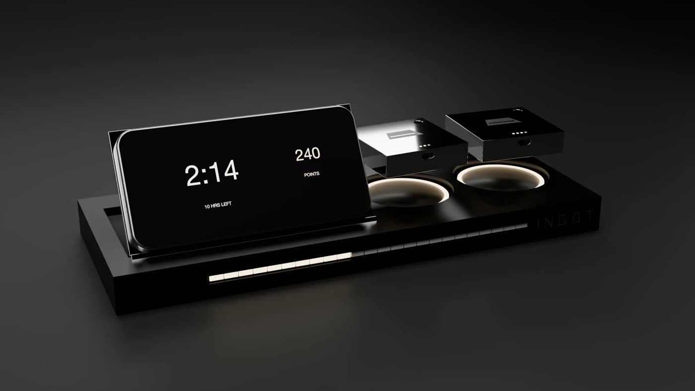
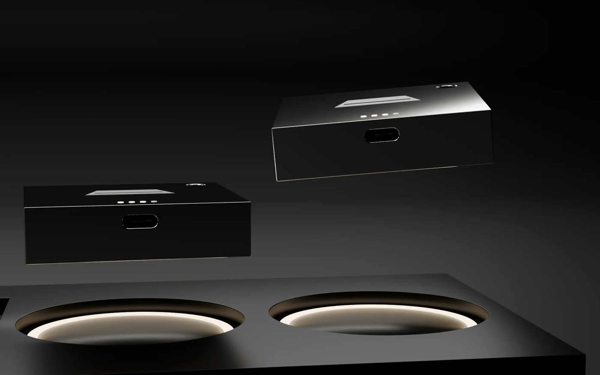
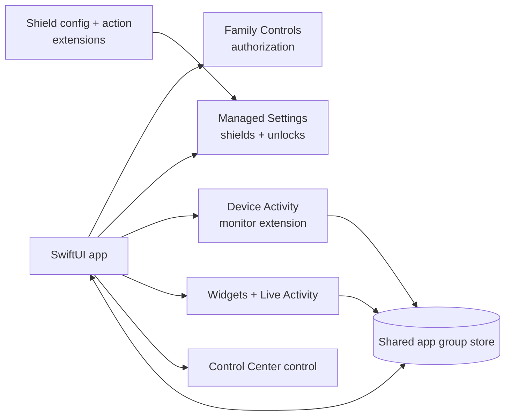

[← All projects](../README.md)

# Ingot

> An iPhone app, and a machined desk dock concept, where you **earn** your screen time instead of having it banned.

   

| At a glance | |
|---|---|
| **What** | Screen time you earn, not screen time you're banned from |
| **For** | People who want to use their phone less without uninstalling everything |
| **Status** | 🟡 App in device testing · dock is a concept |
| **Built with** | SwiftUI · Screen Time APIs · WidgetKit |
| **See it** | Renders below |

**Jump to:** [The problem](#the-problem) · [How it works](#how-it-works) · [The dock (concept)](#the-dock-concept) · [How it's built](#how-its-built) · [The launch site](#the-launch-site) · [Product principles](#product-principles) · [Possibilities](#possibilities)

---

## The problem

Screen time limits fail because they're a wall: you hit the limit, you tap "ignore", and the habit wins. Blocking apps entirely feels like punishment, so people uninstall the blocker. Ingot flips the model. Fun apps aren't forbidden, they're **bought**, with time you spent focused or away from the phone.

## How it works

1. **Every day starts at zero.** Points reset at 4 AM and the apps you choose are locked.
2. **Earn.** Focused time, offline time, or a key session earns **1 point per minute**.
3. **Spend.** Points buy minutes of the locked apps from an in-app shop.
4. **Repeat.** Nothing carries over, so every day is a fresh start rather than a debt.

### Safety valves
- **Quiet hours** for sleep and work blocks.
- **Emergency unlocks** that are always available but deliberately cost something.
- **Never locks** calls, messages, maps or anything essential.

### Glanceable everywhere
- Home screen and Lock Screen **widgets** show points and the day's progress.
- A **Live Activity** shows a running session on the Lock Screen and Dynamic Island.
- A **Control Center control** ("Tap Key") starts a session in one tap.
- **iPhone and iPad sync** so points follow you.

## The dock (concept)

A machined desk object that makes the habit physical:

- Holds the phone at the desk.
- A **24-segment light bar** shows the day hour by hour, lighting up as you earn.
- Two **keys that double as power banks**. Pull a key and the phone locks into a focus session; put it back to end it.
- Dimensions from the CAD model: dock 320 x 125 x 24 mm, keys 60 x 60 x 15 mm.
- Positioned as "Coming 2027". Not manufactured, no price set.

## How it's built

- Native SwiftUI with Apple's **Screen Time APIs**: Family Controls for permission, Managed Settings for locking and timed unlocks, Device Activity for monitoring sessions in the background.
- Custom **shield screens** (what you see when you open a locked app) with their own configuration and action extensions.
- Separate targets for the app, widgets, monitor and shields, sharing one app group store.
- Unit and UI test targets.

## The launch site

A scroll-driven product film: eight chapters, one per scroll step, made from CAD renders restyled with AI image tools and animated with AI video tools that keep the product geometry true from a start and an end frame. Static HTML, no framework, zero maintenance.

## Product principles

1. **Earn, don't ban.**
2. The object should feel like it costs more than it does.
3. Honest about status: coming, not here.
4. One idea per screen.

## Possibilities

- **TestFlight beta** once Apple approves Family Controls distribution.
- **Social pacts:** friends pool points or race a weekly focus goal.
- **Smarter earning:** bonus points for workouts logged in Apple Health or for streaks.
- **Dock prototype:** CNC aluminum shell, NFC in the keys, an ESP32 driving the light bar over Bluetooth.
- **Parent mode:** the same earning model for a kid's device, with the parent setting the exchange rate.

---

[← All projects](../README.md)
