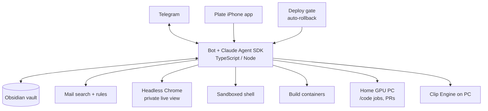

[← All projects](../README.md)

# Jarvis

> My personal AI agent. It lives in Telegram, runs 24/7 on a small cloud server, remembers everything in a notes vault, and does real work: email, browsing, coding, and feeding my other apps.

| At a glance | |
|---|---|
| **What** | Personal AI agent in Telegram that does real work |
| **For** | Me (one user, full trust) |
| **Status** | 🟢 Live, 40+ versions |
| **Built with** | TypeScript · Node · Claude Agent SDK |
| **See it** | Private |

**Jump to:** [The problem](#the-problem) · [What it does](#what-it-does) · [How it works](#how-it-works) · [Version highlights](#version-highlights) · [Possibilities](#possibilities)

---

## The problem

Chat assistants forget you between conversations, can't act on anything, and live in a browser tab. I wanted an assistant that **knows my life**, is reachable from my phone in the app I already use, can **actually do things**, and is safe enough to trust with real access.

## What it does

### Memory
- Keeps a structured **Obsidian notes vault**: daily notes, a journal, projects, people, topics and a "life file" with goals.
- Reads and writes the vault as we talk, so context carries across days and months.
- The vault is backed up nightly, encrypted at rest.

### Email
- **Full mail search** across every message.
- **Sorted digests** instead of a firehose, plus an instant Telegram ping only for mail that actually matters.
- **Junk cleanup:** proposes sender and query rules, trashes on a tap, and sweeps automatically. Well over 100,000 junk emails cleared so far, all reversible (trash, never delete).

### A real browser
- Drives an actual Chrome instance on the server for tasks that need a website.
- I can watch it live from my phone through a private remote view.

### Coding (`/code`)
- Takes a request like "add a dark mode toggle to X", works on my **home GPU PC** over a private network, commits to a `jarvis/...` branch, pushes, and **opens a pull request**.
- A guard on the PC only allows Jarvis branches to leave the machine.

### Workroom
- A **manager agent** splits a big task into pieces, **worker agents** do them in parallel, and a **reviewer** checks the result before it reaches me. Commands to see the board or stop everything.

### Builder and shell
- Runs commands in a **locked-down sandbox** (no access to the agent's own secrets) and can send back files it makes.
- Builds run in throwaway containers with internet-only firewall rules.
- Ships document skills for Word, PDF, PowerPoint and Excel output.

### Feeding my other apps
- **Nutrition mailbox** for my [Plate](plate.md) app: the phone posts "Describe it" requests and gets structured macros back, with lookups against real restaurant nutrition pages.
- **Workouts** from Plate land in the day's note.
- **Lead kits** from [Site Scout](site-scout.md) are delivered to Telegram.
- **Shares AI access** with tools on my home PC, like [Clip Engine](clip-engine.md), so they don't need their own keys.

### Behaving well
- **Asks before anything irreversible**, acts on its own for everything else.
- **Night mode:** non-urgent taps between 11 PM and 7 AM are held for a 7 AM batch.
- **Money and documents:** tracks bills and important docs from alert emails in one signals store, without connecting to a bank.

## How it works

- **TypeScript on Node 22**, the **Claude Agent SDK**, and grammY for Telegram.
- Runs as a system service on a small cloud server, reachable only through a **private mesh network** (no public admin ports).
- **Deploy gate** with health checks and **automatic rollback** if a release misbehaves.
- Token use was cut deliberately (topic pages instead of re-reading everything) so it stays cheap to run all day.

## Version highlights

| Version | Added |
|---|---|
| v0.21 | Nutrition mailbox for Plate |
| v0.23 | Real browser, money + docs tracking, attention signals |
| v0.28 | Sandboxed shell, document skills |
| v0.30 | Full mail search + junk cleanup |
| v0.31 | Sorted digests, important-mail pings |
| v0.33 to v0.35 | Autonomy rules, Workroom, night mode, builder |
| v0.39 | `/code`: PRs from the home PC |
| v0.40 | Shared AI access for home PC tools |

## Possibilities

- **Voice:** call Jarvis or have it place calls (a phone layer is built but turned off for now).
- **Proactive planning:** a morning brief that schedules the day around calendar, energy and deadlines.
- **Home automation** through the always-on PC.
- **Multi-user:** a family or small-team version where each person has a private vault and shared projects.
- **Packaged product:** a one-command install of the same agent for other people on their own server.

---

[← All projects](../README.md)
