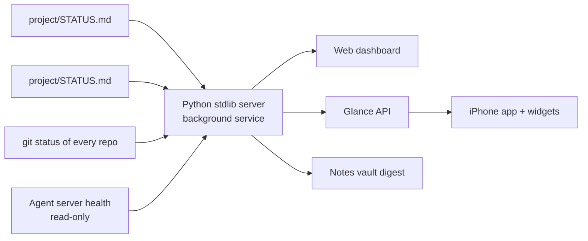

[← All projects](../README.md)

# Mission Control

> One screen that shows the live state of every project I run, on my Mac, my phone and my home screen.

| At a glance | |
|---|---|
| **What** | Dashboard for the state of every project I run |
| **For** | Me, across 20+ projects |
| **Status** | 🟢 In daily use |
| **Built with** | Python · vanilla JS · SwiftUI widgets |
| **See it** | Private (shows private project data) |

**Jump to:** [The problem](#the-problem) · [What it does](#what-it-does) · [How it works](#how-it-works) · [Design](#design) · [Possibilities](#possibilities)

---

## The problem

I run 20+ projects at once: client websites, iOS apps, AI pipelines, infrastructure and school, almost all through Claude Code in the terminal. Without a single view, state lives in scrollback. I'd forget which project was waiting on me, what the next step was, or that something had uncommitted work sitting for a week.

Mission Control answers five questions in under five seconds:
1. What's in flight?
2. What's the next step for each thing?
3. What's waiting on **me** (not on code)?
4. What has drifted (uncommitted, unpushed, stale)?
5. Where did I leave off?

## What it does

- **Reads a STATUS.md in every project.** A tiny shared format: state, phase, the literal next action, owner-only to-dos, completed phases and a dated log. Every AI coding session updates it before stopping, so the dashboard is always current without me doing anything.
- **Detects drift** straight from git: uncommitted files, unpushed commits, and projects that haven't moved in a while.
- **"Blocked on you" inbox** that collects every owner-only to-do across all projects in one list.
- **Agent tab** showing my personal agent's server health, deploys and recent activity, read over a private network.
- **Daily digest** pushed into my notes vault so my agent knows project state too.
- **iPhone app + widgets** (SwiftUI, WidgetKit) reachable only inside my private network, with a glance endpoint built for widgets.
- **Command palette** and full keyboard navigation.

## How it works

- **Python standard library only** for the server and **vanilla JavaScript** for the UI. No frameworks, no build step, nothing to update.
- Runs as a macOS background service that starts at login.
- Telemetry and parsing are covered by a 30+ test suite.

## Design

A graphite, instrument-panel look built for three real uses: an ambient readout pinned on a second monitor all day, a morning check-in to choose what to work on, and late-night work in a dark room. Status is **never shown by color alone** (always a glyph plus a label), contrast meets WCAG AA, and reduced-motion settings stop non-essential animation.

## Possibilities

- **Natural-language updates:** text my agent "Plate: done with search v2" and it edits the STATUS file.
- **Time tracking** inferred from git and session activity, per project.
- **Weekly review** auto-generated every Sunday: what moved, what stalled, what to drop.
- **Shared mode** for a small team, where each person sees their own "Blocked on you".

---

[← All projects](../README.md)
