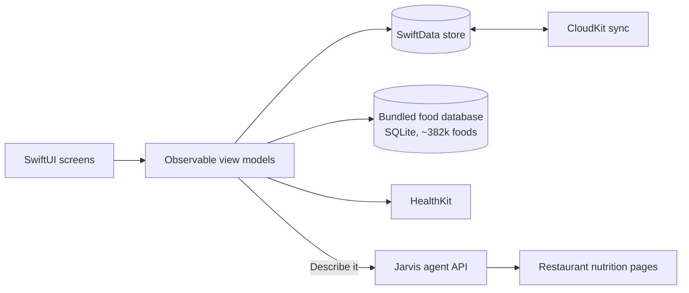

[← All projects](../README.md)

# Plate

> A nutrition and training tracker for iPhone, built from scratch to replace MyFitnessPal. Native, offline-first, no ads, no paywall, no third-party code. In daily use.

| At a glance | |
|---|---|
| **What** | Food + training tracker for iPhone |
| **For** | Anyone tracking macros and lifts who wants speed and no subscription |
| **Status** | 🟢 In daily use |
| **Built with** | SwiftUI · SwiftData · CloudKit · HealthKit |
| **See it** | Private app (personal device install) |

**Jump to:** [The problem](#the-problem) · [What it does](#what-it-does) · [How it works](#how-it-works) · [Design](#design) · [Quality](#quality) · [History](#history) · [Build timeline](#build-timeline) · [Possibilities](#possibilities)

---

## The problem

Every popular tracker has the same issues: search waits on a server, barcodes fail offline, the useful features sit behind a subscription, and the app is full of things I never touch. I wanted one app that does food and training, opens instantly, works with no signal, and where every feature that exists is one I actually use and works every single time.

That became the rule for the whole project: **lean and flawless.** If a feature is unreliable it gets redone. If it's obsolete it gets deleted.

## What it does

### Food logging
- **Instant search over ~382,000 foods.** The full USDA branded and generic database ships inside the app as a local SQLite file, so search never waits on a network.
- **Typo-tolerant matching.** "chiken brest" still finds chicken breast. Brand names and generic foods rank sensibly together.
- **Offline barcodes.** Scan a package with no signal and it still resolves, because barcodes are indexed locally too.
- **"Describe it."** Type a meal in plain words ("Chipotle burrito bowl, double chicken, no rice") and an AI lookup, routed through my personal agent [Jarvis](jarvis.md), returns a structured entry with calories and macros in about 8 to 12 seconds. It checks real restaurant nutrition pages when it can instead of guessing.
- **Meals, recents and favorites** so a normal day takes a few taps.
- **Custom foods and serving sizes** for anything not in the database.

### Nutrition targets
- Daily calorie and macro targets with live progress rings.
- Day, week and trend views to see how a week actually went, not just today.
- Meal photos attached to entries.

### Training
- **Programs and routines:** build a program, schedule routines, and start a workout from today's plan.
- **Workout logging:** sets, reps, weight, with previous numbers shown inline so progressive overload is obvious.
- **Entry editor** for fixing any past set or workout.
- Training history feeds into the same calendar as food, so one screen shows the whole day.

### Calendar
- A month view where every day shows food and training at a glance, with photos.

### Sync and health
- **iCloud sync** across devices through CloudKit, with no account to create.
- **Apple Health** read and write.

## How it works

- **SwiftUI + SwiftData**, with CloudKit-backed sync. No third-party packages at all, which means nothing to update, nothing that breaks on an iOS release, and nothing tracking anyone.
- **Bundled read-only food database** built offline from USDA FoodData Central, indexed for prefix, fuzzy and barcode lookups.
- **Agent-backed lookups** go through an authenticated mailbox on my own server instead of calling an AI provider from the phone, so no API keys live in the app.

## Design

A custom design system called **Graphite & Ice**: dark graphite surfaces, icy accents, dense but calm data, large tap targets for logging with one hand at the gym. Every screen is verified on all four iPhone widths.

## Quality

- **570+ unit tests** covering macro math, search ranking, serving conversion, training logic and sync edge cases.
- Automated screenshot audits across device sizes after every design pass.
- Installed and used on real devices daily, which is the real test.

## History

Plate replaced an earlier attempt, **CalToGo**, a macro tracker backed by a hosted database. Moving to a local-first SwiftData design removed the server dependency entirely, which made the app faster and free to run forever.

## Build timeline

| Phase | What shipped |
|---|---|
| Nutrition core | Food database, search, logging, targets |
| Redesign | Graphite & Ice design system |
| Calendar + photos | Month view, meal photos |
| Training (T0 to T9) | Programs, routines, workouts, history, editor |
| Food logging rebuild | Faster flows, better recents and meals |
| Food search v2 | 382k branded foods, typo tolerance, offline barcodes |
| Describe it | AI meal lookup via Jarvis |

## Possibilities

- **Photo logging:** snap a plate and get a first-draft entry, confirmed in one tap.
- **Adaptive targets** that adjust calories from real weight trend data instead of formulas.
- **Apple Watch** set logging and rest timers.
- **Coach view:** share a read-only week with a trainer or dietitian.
- **App Store release** with a one-time price instead of a subscription.
- **Restaurant menus offline:** cache chain menus the same way the USDA data is cached.

---

[← All projects](../README.md)
