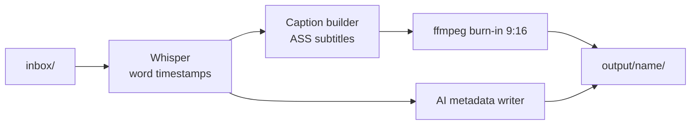

[← All projects](../README.md)

# Reel Captioner

> Drop a short video in a folder and get it back captioned, with paste-ready titles, descriptions and hashtags for every platform. Runs locally on a Mac.

| At a glance | |
|---|---|
| **What** | Auto-captions and platform copy for short videos |
| **For** | Creators posting one video to several platforms |
| **Status** | ⚪ Working, parked |
| **Built with** | Python · Whisper · ffmpeg |
| **See it** | Private |

**Jump to:** [The problem](#the-problem) · [What it does](#what-it-does) · [How it works](#how-it-works) · [What it led to](#what-it-led-to) · [Possibilities](#possibilities)

---

## The problem

Posting one short video to three platforms means captioning it, then writing three different titles, descriptions and hashtag sets. It's the same 20 minutes every time.

## What it does

- **Local transcription** with Whisper. Nothing is uploaded, which matters for client footage.
- **Animated word-by-word captions** burned into a 9:16 video, with the active word highlighted.
- **Safe-zone aware:** captions sit where app buttons and usernames won't cover them on Reels or Shorts.
- **Platform metadata written from what was actually said**, so keywords match the content:
  - YouTube title, description and tags
  - Instagram caption and hashtags
  - Facebook caption and hashtags
- **Watch mode:** drop files into an inbox folder and they process automatically.
- Outputs the captioned video, a Markdown file to copy from, structured JSON, and the transcript to proofread names.

## How it works

- Python with **zero pip installs**: it calls `whisper` and `ffmpeg` directly and talks to the Claude API through the standard library.
- Every look (font, size, position, colors, models) is a setting in one config file.

## What it led to

Reel Captioner was the seed for [Clip Engine](clip-engine.md), which does the same captioning plus moment picking, reframing and posting for long-form video.

## Possibilities

- **Brand presets** per client (fonts, colors, logo bug).
- **Translation** into a second caption track.
- **Auto-chapters** and thumbnails for YouTube.

---

[← All projects](../README.md)
