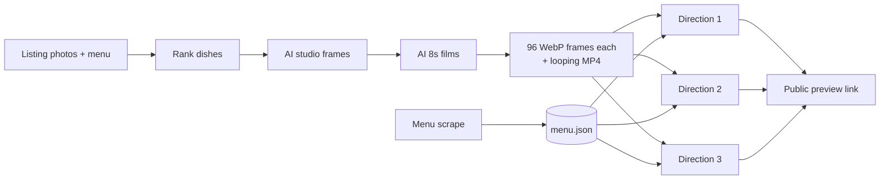

[← All projects](../README.md)

# Restaurant Film Sites

> Spec websites for local restaurants with broken websites, where every signature dish is a short studio film generated from the restaurant's own photos. Three complete design directions per restaurant, so the owner picks.

| At a glance | |
|---|---|
| **What** | Restaurant sites where every dish is a short film |
| **For** | Local restaurants with dead websites |
| **Status** | 🟡 Two restaurants pitched |
| **Built with** | Next.js · AI image + video |
| **See it** | Private previews (shown in person) |

**Jump to:** [The idea](#the-idea) · [How each pitch is made](#how-each-pitch-is-made) · [How it works](#how-it-works) · [Process as product](#process-as-product) · [Possibilities](#possibilities)

---

## The idea

Restaurant sites usually show a few phone photos and a PDF menu. People choose where to eat with their eyes. For restaurants whose websites had died, I build a site where **the food moves**, before they pay anything, and show it on my phone at their counter.

## How each pitch is made

1. **Real food only.** Dish photos come from the restaurant's own public listing. Nothing is invented.
2. **Rank the dishes** by what the restaurant would want to lead with: the signature item, the most praised dish in reviews, the dish that defines the cuisine, the best seller, then a closer.
3. **Studio frames.** Each phone photo is restyled with an AI image model into a consistent studio shot: same dish, same plating, a dark seamless set, rim light, a soft brand-color glow, no text or hands.
4. **Films.** Each frame becomes an 8-second continuous shot with an AI video model: sauce drizzling, tobiko raining down, hibachi flame flaring, a marble dropping into a soda bottle. Six films per restaurant.
5. **Full menu.** The complete menu with real prices (190+ items for one restaurant), scraped from the public listing into structured data, with search and a vegetarian filter.
6. **Three directions** on the same film set:
   - **Cinematic dark:** each dish a full-screen film you scrub with your thumb.
   - **Loud poster:** bold display type, looping films in shaped frames, sticker prices, a sideways rail.
   - **Light day-in-the-life:** the film grows out of a card, then a timeline from opening to close.
7. **One link that opens on any phone,** with a picker page and a 1/2/3 switcher, hidden from search engines.

## How it works

- Next.js 16, Tailwind v4, next/font.
- **Scroll-scrubbed film:** each film is cut into 96 compressed frames drawn to a canvas as you scroll, loaded coarse-to-fine so it's usable immediately. A single CSS variable drives every overlay off scroll progress.
- **Looping clips** play only while on screen.
- Respects reduced-motion settings.
- Checked at phone width for overflow, readable buttons on every background, and long dish names that still fit.

## Process as product

Every correction from a real pitch is written into a playbook, so the whole flow (photos, ranking, films, three directions, live link) is on its way to being a single command in [Site Scout](site-scout.md). The second restaurant took one session end to end.

## Possibilities

- **One-command pitches** for any restaurant with a listing.
- **Seasonal refresh:** new films when the menu changes.
- **Online ordering** for restaurants that only have a third-party listing today.

---

[← All projects](../README.md)
