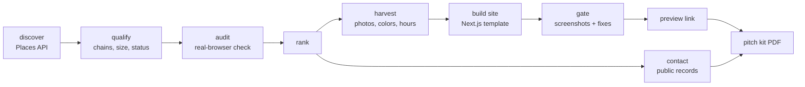

[← All projects](../README.md)

# Site Scout

> Finds local businesses whose websites are broken, missing or out of date, builds a preview of a better site for each, and prepares the in-person pitch. The engine behind my website business.

| At a glance | |
|---|---|
| **What** | Finds businesses with broken websites and prepares the pitch |
| **For** | My web studio |
| **Status** | 🟢 Used weekly |
| **Built with** | Python · Places API · Next.js · Playwright |
| **See it** | Private |

**Jump to:** [The problem](#the-problem) · [What it does](#what-it-does) · [How it works](#how-it-works) · [By the numbers (first sweep)](#by-the-numbers-first-sweep) · [Possibilities](#possibilities)

---

## The problem

Small local businesses often have a dead website and don't know it: the domain lapsed, the hosting bill bounced, the SSL certificate broke, or the "site" is a template that never loads on a phone. Customers bounce and the owner never hears about it. Finding these businesses by hand is slow, and cold pitches without anything to show rarely work.

Site Scout's answer: **find them automatically, and show up with their new site already built.**

## What it does

### 1. Discover
- Sweeps outward from a starting address in rings and collects every business nearby from the Google Places API.
- Filters out chains and franchises, businesses that are closed, categories that don't fit, and places too small to afford ongoing care (under 25 reviews).
- Tracks API usage against free-tier limits so it never runs up a bill.

### 2. Audit
- Loads each website the way a real visitor would, with a real browser user agent.
- Classifies it: **ok, none, dead, blocked**. Dead covers lapsed domains, DNS failures, SSL errors, "renew your subscription" pages and 404s.
- Re-checks dead sites before a pitch, because transient failures happen.

### 3. Rank
- Scores each lead by how broken the web presence is, how strong the business is (rating, review count), and distance.
- A hand-checked shortlist sits on top of the automatic ranking.

### 4. Harvest and build
- Pulls the business's public listing photos, hours, brand colors and fonts (including from archived copies of a dead site).
- Generates a **complete preview website** from a Next.js template.
- Runs an automated **gate**: screenshots at phone, tablet and desktop widths, a design score, and up to three fix rounds before it passes.
- Deploys a preview link.

### 5. Find the owner
- Resolves the legal entity behind a storefront from public **state sales-tax permit and franchise-tax records**, then the listed officers. Never guesses: no match means no name.

### 6. Pitch kit
- A printed **leave-behind PDF** with a QR code to the preview and the plans.
- A short guide: who to ask for, when to visit, and what to say.
- Delivered to my phone through my agent, [Jarvis](jarvis.md).

### 7. The pitch playbook
For the strongest leads I build a full **three-direction pitch** with AI-generated food films (see [Restaurant Film Sites](restaurant-film-sites.md)). Every correction from those builds goes into a written playbook, so the whole flow can become one command.

## How it works

- Python standard library, a SQLite lead database with an event history per lead, Playwright for audits and screenshots, Vercel for previews.
- Only **public** business information. Nothing is ever sent to a business automatically, and leads are reviewed only when I ask.
- 30+ tests.

## By the numbers (first sweep)

- ~1,100 businesses found within about 3 miles.
- ~390 dropped as too small, ~290 as chains, ~30 as closed.
- Of qualified sites: ~300 fine, ~27 with no site, ~14 blocked, a handful dead.
- 5 complete preview sites generated and passed the gate in one batch.

## Possibilities

- **`sitescout pitch <lead>`:** the full playbook (films, three directions, live link) as one command.
- **Outcome tracking:** visited, interested, signed, with follow-up reminders.
- **Other cities** with one config change.
- **Monitoring for clients:** the same audit, run nightly against sites I manage, alerting before a customer notices.

---

[← All projects](../README.md)
