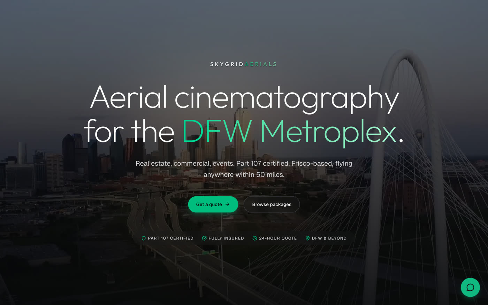
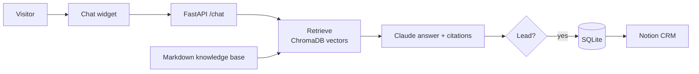

[← All projects](../README.md)

# SkyGrid Aerials Site + AI Chat

> A marketing site for a Dallas-Fort Worth drone videography business, with a retrieval-augmented AI chat assistant that answers customer questions and captures leads.

  

| At a glance | |
|---|---|
| **What** | Drone business site with an AI chat that captures leads |
| **For** | People shopping for drone photo and video in DFW |
| **Status** | 🟢 Live |
| **Built with** | Next.js · FastAPI · ChromaDB · Claude |
| **See it** | [skygrid-site.vercel.app](https://skygrid-site.vercel.app) |

**Jump to:** [The problem](#the-problem) · [The site](#the-site) · [The AI chat](#the-ai-chat) · [Possibilities](#possibilities)

---

## The problem

People shopping for drone work ask the same questions (pricing ranges, what's allowed, turnaround, weather, what to prepare) and most leave without asking. A chat that answers accurately, any time, and passes serious inquiries to a human turns more visitors into conversations.

## The site

- Next.js 16, TypeScript, Tailwind v4, shadcn/ui.
- Animated backgrounds, number tickers and motion throughout, kept to a strict design discipline.
- Analytics to see which pages drive inquiries.

## The AI chat

### What it does
- **Answers from a curated knowledge base** of Markdown documents about services, process and policies, never from general web knowledge.
- **Cites its sources** so answers can be checked.
- **Qualifies and captures leads** during the conversation and records them.
- **Syncs leads to a Notion database** where they can be followed up.
- Keeps per-visitor sessions so follow-up questions have context.

### API
| Endpoint | Purpose |
|---|---|
| `POST /chat` | One chat turn: returns the answer, citations, and whether a lead was captured |
| `GET /health` | Status: knowledge chunk count, model, Notion connection, active sessions |

### How it works

- **FastAPI**, **ChromaDB** vector search and **Claude**, deployed separately from the site.
- Leads go to SQLite first and then Notion, so nothing is lost if Notion is unavailable.

## Possibilities

- **Quote builder:** turn a conversation into a draft quote with a shot list.
- **Airspace check:** look up whether an address is in controlled airspace before quoting.
- **Booking** straight from the chat.

---

[← All projects](../README.md)
