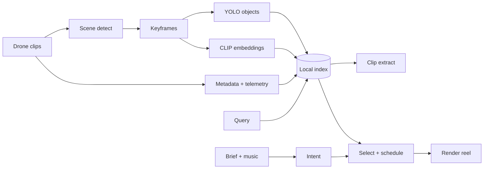

[← All projects](../README.md)

# SkyGrid Auto-Editor

> An auto-editor for drone footage. Index a folder once, then search it in plain language or have it cut a beat-synced reel from a one-line brief.

| At a glance | |
|---|---|
| **What** | Search and auto-edit for drone footage |
| **For** | Drone shooters with hours of unsorted clips |
| **Status** | 🟡 v0.2 alpha |
| **Built with** | Python · YOLO · CLIP · librosa |
| **See it** | [Public code](https://github.com/Manvi0b/skygrid-shot-search) |

**Jump to:** [The problem](#the-problem) · [What it does](#what-it-does) · [How it works](#how-it-works) · [Possibilities](#possibilities)

---

## The problem

Drone shooters come home with hours of near-identical clips. Finding "the sunset orbit over the lake" means scrubbing through everything, and cutting a reel to music is another hour on top.

## What it does

### Index
- **Scene detection** splits every clip into shots.
- **Object detection** (YOLO) and **visual embeddings** (CLIP) for keyframes in every scene.
- **Camera metadata:** resolution, aspect, lens, plus **GPS-derived local time** so "golden hour" means golden hour where it was shot.
- **Drone telemetry** from subtitle tracks (altitude, speed) for filters.
- Works from low-res proxy files for speed, cuts from the originals.
- **Idempotent:** re-indexing an already indexed folder finishes in well under a second.

### Search
- Plain-language queries ("boat wake from above, slow push").
- Object queries ("cars", "people").
- An "interesting moments" mode that surfaces shots worth a look.
- Hybrid filters (time of day, altitude, score thresholds).
- **Lossless cuts** of the matching clips by default.

### Make a reel
1. Describe what you want and give it a music track.
2. It **detects the beats** in the music.
3. An AI step turns the brief into intent (mood, pacing, subjects) through a short dialog.
4. A **selector** picks varied, relevant shots (maximal marginal relevance, so it doesn't pick five copies of the same view).
5. A **scheduler** paces cuts to the beat.
6. A two-pass ffmpeg composer renders the final reel.

## How it works

- Python 3.12, PySceneDetect, YOLO11n, CLIP ViT-B-32, librosa, ffmpeg.
- **Fully offline** on an Apple Silicon Mac after the first model download. Only the reel brief calls an AI model, at about two cents per reel.

## Possibilities

- **Color matching** across shots in a reel.
- **Client delivery:** a shareable gallery of search results.
- **Auto-tagging** for stock footage marketplaces.
- **Real estate mode:** pull the standard shot list (front, rear, orbit, neighborhood) automatically for listing videos.

---

[← All projects](../README.md)
