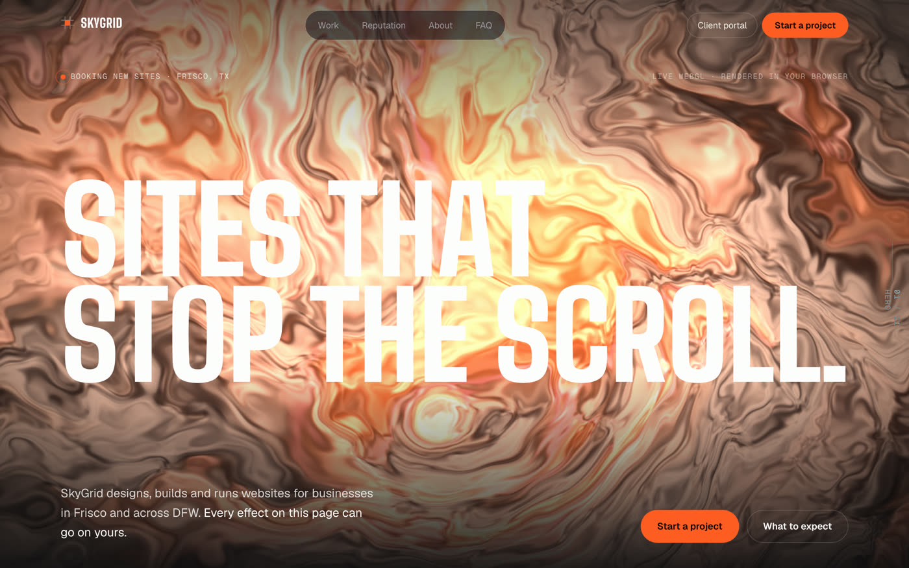
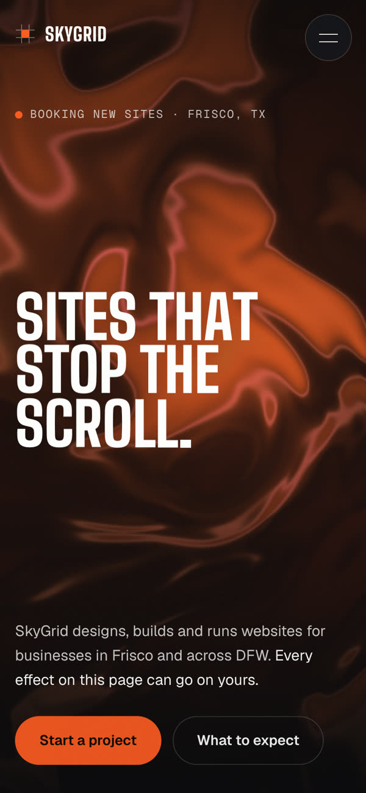
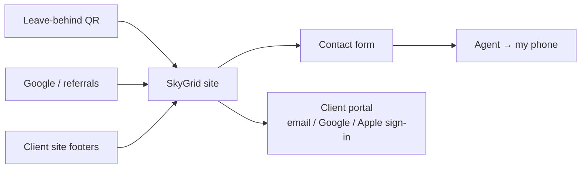

[← All projects](../README.md)

# SkyGrid Websites

> The site for my web design studio, which designs, builds and runs websites for local businesses month to month. Includes a client portal.

  
  

| At a glance | |
|---|---|
| **What** | My web studio's site and client portal |
| **For** | Local businesses deciding whether to hire me |
| **Status** | 🟢 Live · v5 in preview |
| **Built with** | Next.js 16 · Tailwind v4 |
| **See it** | [skygridwebsites.vercel.app](https://skygridwebsites.vercel.app) |

**Jump to:** [What the business does](#what-the-business-does) · [What the site has to do](#what-the-site-has-to-do) · [What's on it](#whats-on-it) · [Client portal](#client-portal) · [How it's built](#how-its-built) · [Possibilities](#possibilities)

---

## What the business does

SkyGrid Websites designs, builds and maintains websites for businesses, and makes the creative around them: flyers and print, short-form video, and drone photo and video through its sister company SkyGrid Aerials. The model is **built before you pay**: for local businesses I often build the new site first (see [Site Scout](site-scout.md)) and show it in person. After launch it's ongoing care: hosting, updates and Google listing upkeep, month to month.

## What the site has to do

Prospects arrive from an in-person pitch (a printed leave-behind with a QR code), Google, referrals, or a "Site by SkyGrid" footer link, usually on a phone between customers. The site has to **prove craft through real work, answer every question up front, and turn interest into a conversation**, so a prospect gets in touch already convinced.

## What's on it

- **Home:** a motion-led hero and a tour of what a client site can do.
- **Work:** real client projects, plus clearly labeled **concept sites** for made-up brands that show range. No invented testimonials, logos, client counts or results.
- **About**, **FAQ** and a **Start** page that walks through the process.
- **Reputation:** the Google listing and review care that comes with a plan.
- **Quick contact:** a form delivered straight to my phone through my agent, plus tap-to-call.
- **No pricing on the site,** by design. Plans are discussed in person.

## Client portal

- Sign in with email, Google or Apple.
- **Per-client routing:** each client lands on their own space.
- Built so requests, files and site status can live in one place instead of in texts.

## How it's built

- Next.js 16, React 19, Tailwind v4, TypeScript.
- Custom shader-based visuals on inner pages, a UI lab for interactive demos, and a reusable motion system.
- All copy in one content file; contact goes through a small server route to my agent.
- Vercel hosting with preview deploys for every redesign.

## Possibilities

- **Portal features:** request an edit, upload photos, see uptime and traffic for your site.
- **Online booking** for a 15-minute call.
- **Case studies** with real before-and-after numbers once clients have a few months of data.

---

[← All projects](../README.md)
