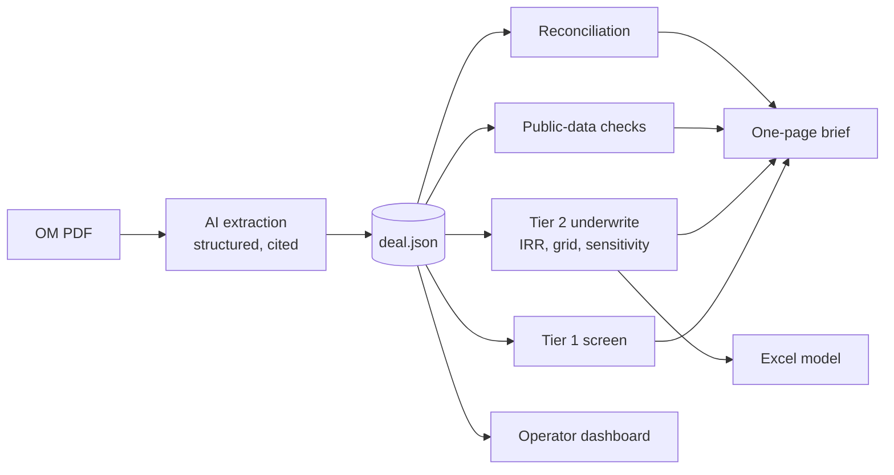

[← All projects](../README.md)

# Acquisition Underwriting Engine

> A deal-screening and underwriting tool for a Dallas-Fort Worth commercial real estate operator. It reads a broker's offering memorandum, recomputes every number itself, checks the claims against public data, and hands back a one-page brief and a live Excel model.

| At a glance | |
|---|---|
| **What** | Commercial real estate deal screener and underwriter |
| **For** | A DFW real estate operator screening offering memos |
| **Status** | 🟢 All phases built |
| **Built with** | Python · AI extraction · Excel |
| **See it** | Private (client) |

**Jump to:** [The problem](#the-problem) · [What it does](#what-it-does) · [How it works](#how-it-works) · [Possibilities](#possibilities)

---

## The problem

Brokers send offering memorandums (OMs) that present a property in the best light: optimistic income, missing expenses, the property tax at the seller's old assessment rather than what a buyer will actually pay after the sale. Screening dozens of these by hand is slow, and trusting the OM's numbers is how bad deals get bought.

The goal was a tool that is **more trustworthy than the document it reads**: catch the typo, recompute the income, surface what's missing.

## What it does

### Read the deal
- **PDF to structured data:** an AI extraction step with strict structured output turns an OM into a deal file. It's idempotent, cites where each number came from, and quarantines marketing boilerplate.

### Screen it (tier 1)
- Underwritten **net operating income** built from the engine's own assumptions, not the seller's.
- **Cap rate, debt service coverage, debt yield**, the year leverage breaks even, and a disposition with a priority.

### Underwrite it (tier 2)
- A levered **hold-to-sale pro forma**: **levered and unlevered IRR**, equity multiple, cash-on-cash.
- A **scenario grid** across interest rate, leverage, occupancy, rent growth and exit cap (108 cells).
- A **sensitivity surface** that names the single input the deal is most exposed to.

### Land and owner-user deals
- A **land facts card** that is never scored, because land isn't an income property.
- An **owner-user cost comparison**: buy versus lease net present value, including a hybrid option.

### Verify against public data
- **Traffic counts** from the state transportation department.
- **Flood zones** from FEMA.
- **Environmental records** from the EPA.
- **SEC filings** for public tenants.
- **County appraisal district** data: true owner, appraised value, and **the real property tax after the sale reassesses the property**.
- Each check reports how far the OM deviates from what was found.

### Reconcile
- Rent roll versus trailing-twelve-month financials versus marketing claims, aware of where each number came from.

### Deliver
- A **one-page brief** that leads with the decision.
- A populated **Excel model** with live formulas and every input cell cited back to its source, written with no spreadsheet library.
- An **operator dashboard** across every deal: an attention queue, a sortable pipeline, and per-deal panels.

### Automate intake
- Drop a PDF into an intake folder and the brief appears, filed with the archived PDF.
- Follow-up requests to brokers are **drafted and queued, never sent automatically**.
- The folder structure and the deal files stay in sync.

## How it works

- Python, built as a learning project too, so the code favors readability and correctness over cleverness.
- A strict **permission boundary**: only allowlisted public data hosts, nothing sent without approval.
- **100+ tests** that run fully offline using recorded extraction responses.

## Possibilities

- **Comparable sales** pulled automatically to sanity-check exit cap rates.
- **Lender quotes** fed in to replace assumed debt terms.
- **Portfolio view** of owned assets using the same engine for annual re-underwriting.
- **Broker scorecards:** how far each broker's OMs typically deviate from reality.

---

[← All projects](../README.md)
